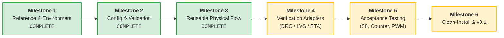
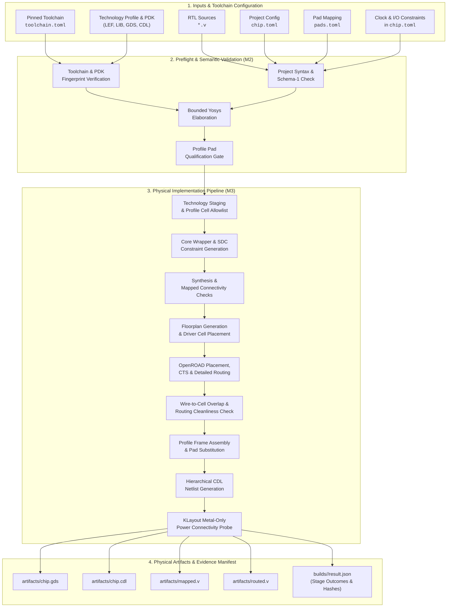
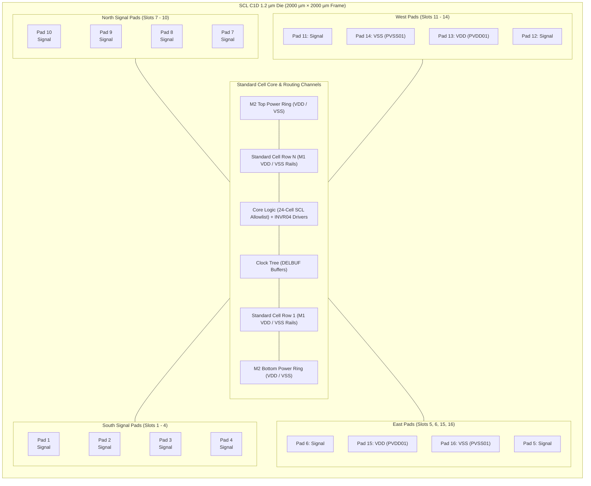
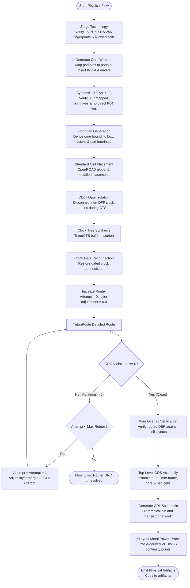

# Tapeout Automation

`chipflow` is a generic, provenance-first chip automation engine. It takes a chip project—RTL, `chip.toml`, `pads.toml` and constraints—and produces a reproducible build, physical artifacts and an evidence manifest retaining inputs, logs, hashes and structured results. Supported designs use the shared engine without chip-specific engine edits. The first supported technology profile is **SCL C1D 1.2 µm on the 2×2 mm frame**; S8 is the reference project used to exercise it.

---

## Current status and roadmap

As of **9 November 2026**, Milestones **1, 2 and the documented S8 physical-flow scope of 3** pass their acceptance gates. The current development package is **0.1.0.dev5**; the [verification closeout](docs/milestone-3-verification.md) records all five findings resolved.



- **Milestone 1 — Reference and environment:** Immutable current-S8 engineering reference, contracts and inventories, plus a pinned binary runtime installed and probed in fresh isolated Ubuntu userspace.
- **Milestone 2 — Configuration and execution:** Strict schema-1 project and pad map loaders, bounded Yosys elaboration and clock cone analysis, 10 pad qualification checks, mapped netlist checking, isolated execution and provenance tracking. Full `chipflow validate` returns 0 on clean preflight.
- **Milestone 3 — Reusable physical flow:** Technology staging, synthesis, wrapper and constraint generation, OpenROAD placement/CTS/routing, GDS assembly, CDL generation and metal-only power connectivity checks. The S8 build produces all four canonical physical artifacts.

Milestone 3 closeout verifies **138/138 Linux tests**, 126 Windows tests with 12 explicit skips, installed-wheel checks, full installed-package S8 and changed-constraint builds, baseline layout/schematic equivalence, and negative regression cases. See the [verification report](docs/milestone-3-verification.md) and [implementation status](docs/implementation-status.md).

The [S8 downstream run](docs/s8-downstream-verification.md) completes DRC/LVS,
500 functional tests, 36 routed RAM cases, four intended timing negatives and
formal/clock/model checks. Its design status is **FAIL (exit 1)**: full-chip input
hold timing fails under the declared board assumptions, and raw extraction
remains unvalidated. Pad slew/model limitations also remain open.

> [!WARNING]
> **Build completion is not yet signoff qualification.** Milestone 4 is in progress: the build now runs DRC, LVS and presubmission checks ([progress](docs/milestone-4.md)), while timing, simulation and report adapters remain open; broader S8/counter/PWM acceptance is Milestone 5, and clean-install qualification and the v0.1 release are Milestone 6. The known raw parasitic extraction failure and unresolved manual items remain open; `signoff_ready` remains false.

---

## Scope and supported targets

The current scope is reusable across **designs within one supported technology profile**: synchronous, single-clock digital standard-cell designs on SCL C1D 1.2 µm, initially the 2×2 mm frame. The project interface supports ordered RTL files, contiguous one-dimensional packed buses, synchronous resets, explicit clock and I/O constraints, and pad/driver choices from the tested profile allowlist. WSL Ubuntu 24.04 on x86-64 with pinned tools is the reference environment; other Linux environments need separate installation qualification.

Other foundries and die sizes, arbitrary analog design, embedded memory macros, multiple clock domains, internal generated/gated clocks, asynchronous-reset flops, latches and bidirectional I/O are outside the first-release boundary. S8's externally gated SCK output is a project-specific exception with dedicated checks. Users supply and verify their circuit design; `chipflow` automates implementation and checks.

S8 is the only project exercised through the physical flow so far. Broader S8/counter/PWM acceptance remains Milestone 5 work. See [supported configurations](docs/supported-configurations.md) and the [first-release boundary](BUILD_PLAN.md#objective-and-first-release-boundary).

---

## End-to-end automation architecture

The reusable engine coordinates immutable runs, deterministic tool invocations and strict stage contracts. Project inputs describe the chip; the technology profile supplies process and frame rules; the separate toolchain configuration supplies pinned tools and PDK locations.



---

## Supported technology profile: SCL C1D 1.2 µm

The current SCL profile provides a fixed 2000 µm × 2000 µm boundary with 16 peripheral pad sites (12 configurable signal pads and 4 dedicated power pads: 2× `PVDD01`, 2× `PVSS01`). Its standard-cell allowlist contains 24 cells. Standard cells are organized in horizontal rows (height 48.7 µm, site pitch 4.2 µm) with M1 power rails and M2 top/bottom power distribution rings. These are technology-profile properties, rather than requirements of every chip automation engine.

The pad-frame schematic below follows the [checked-in profile](tools/chipflow/chipflow/technologies/scl_c1d/profile-0.1.0.toml). Signal cell choices and port assignments come from each project's `pads.toml`; S8's SCK gate and CTS hook belong to its project configuration.



### Physical flow execution and retry loop

The physical flow implements automated retries during detailed routing (`TritonRoute`) by incrementally tuning global route layer adjustments (`0.04 × attempt`) to eliminate router DRC violations before layout assembly. The CTS isolation/reconnection steps below apply when the project enables that hook, as S8 does.



---

## Worked example: S8 reference chip

S8 is a bit-serial 8-bit CPU and the reference project in [projects/s8](projects/s8). It is the only design run through the physical flow so far. Its RTL, pad map, constraints and enabled hooks exercise the shared engine on the SCL C1D profile; they do not define the engine's identity. All images in `docs/images/` are S8 outputs and illustrate this example, rather than qualification of other designs or technologies.


*Figure 1: S8 reference chip, assembled die on the SCL C1D 1.2 µm 2×2 mm frame (OS0000.gds), with 16 peripheral pad sites and the standard-cell core.*

### Visual layout and physical evidence

| S8: 2×2 mm Pad Frame Layout | S8: Core Floorplan & Cell Rows |
|:---:|:---:|
|  |  |
| *S8 output: fixed SCL C1D perimeter frame with 16 pad slots* | *S8 output: standard-cell placement rows and horizontal channels* |

| S8: Clock Tree Distribution | S8: Routing Density & Congestion |
|:---:|:---:|
|  |  |
| *S8 output: clock tree with the project's clock-gate isolation hook* | *S8 output: global and detailed route congestion map* |


*Figure 2: S8 reference chip, magnified core logic rows, standard-cell boundary alignment and dual-layer routing (M1/M2).*

---

## Quick start

Use **Python 3.11 or newer**. Run EDA commands in **WSL Ubuntu 24.04, x86-64**, with the pinned tools and PDK inputs configured in `toolchains/local.wsl.toml`. That file contains machine-specific paths and hashes; use the [toolchain recipe](toolchains/README.md) and [pinned runtime reconstruction](toolchains/milestone1/README.md) for environment details. Installing the Python package alone does not install the EDA tools or PDK.

### Run the reference example

From the repository root, using the Python environment configured for those tools, run S8:

```bash
python -m pip install ./tools/chipflow
chipflow --version

# Check the pinned environment and run synthesis/geometry probes.
chipflow doctor --toolchain toolchains/local.wsl.toml --probe --run-root work/probes

# Check project structure without running EDA tools.
chipflow validate projects/s8/chip.toml --structure-only

# Run full semantic preflight: toolchain, elaboration and configuration.
chipflow validate projects/s8/chip.toml --toolchain toolchains/local.wsl.toml

# Run preflight and physical implementation.
chipflow build projects/s8/chip.toml --toolchain toolchains/local.wsl.toml
```

Each full validation or build creates a retained run under `projects/s8/builds/`. Runs include `result.json`, input and run manifests, and stage evidence. A successful physical implementation produces:

```text
artifacts/chip.gds
artifacts/chip.cdl
artifacts/mapped.v
artifacts/routed.v
```

The current full build **exits 2 even when physical implementation succeeds**, because required downstream verification checks remain `NOT RUN`. Inspect `result.json` for individual stage and check outcomes. Exit 0 from validation covers preflight only; it does not certify a chip. See the [result contract](docs/result-contract.md) for exit-code and evidence rules.

### Bring your own chip

Create a project directory for a design within the supported SCL C1D profile and supply:

- **RTL:** ordered `.v`/`.sv` sources, a top module, and any declared includes, defines and parameters.
- **`chip.toml`:** project and technology selection, clock/reset declarations, build settings, verification requirements and declared test/data dependencies.
- **`pads.toml`:** an explicit mapping for every profile signal slot, with allowed pad/driver choices or a supported unused-slot policy.
- **Constraints:** reviewed clock and min/max I/O timing, output loads and min/typ/max corners in the typed `chip.toml` fields. The engine generates stage-specific constraints from these values.

Follow the [project format](docs/project-format.md) and [current validation contract](docs/m2-validation-contract.md). Supply design-specific tests and dependencies as well; S8's CPU/RAM checks and electrical assumptions are specific to S8. The project-format example records the Milestone 1 structural contract and is not a physically qualified template.

For a project you create at `projects/my-chip`, use the existing commands:

```bash
chipflow validate projects/my-chip/chip.toml --structure-only
chipflow validate projects/my-chip/chip.toml --toolchain toolchains/local.wsl.toml
chipflow build projects/my-chip/chip.toml --toolchain toolchains/local.wsl.toml
```

No shared-engine edits are required for a supported chip. New projects retain the same verification limits and nonzero full-build result described above; counter/PWM physical acceptance is still pending.

---

## Tests

From `tools/chipflow`, run the suite on Windows or Linux:

```bash
python -m unittest discover -s tests -v
```

Real-tool integration tests skip unless `CHIPFLOW_TEST_TOOLCHAIN` points to a configured toolchain file. To include them in the configured WSL environment:

```bash
CHIPFLOW_TEST_TOOLCHAIN="$PWD/../../toolchains/local.wsl.toml" python -m unittest discover -s tests -v
```

---

## Documentation

- [Build plan](BUILD_PLAN.md) and [implementation status](docs/implementation-status.md)
- [Milestone 1 reference](docs/milestone-1.md), [Milestone 2 report](docs/milestone-2.md) and [Milestone 2 closeout evidence](docs/milestone-2-verification.md#final-closeout-8-november-2026)
- [Milestone 3 physical flow and verification evidence](docs/milestone-3.md)
- [Getting started and environment details](docs/getting-started.md)
- [Project format](docs/project-format.md), [validation contract](docs/m2-validation-contract.md), [stage contracts](docs/stage-contracts.md) and [result contract](docs/result-contract.md)
- [Reference limitations](reference/milestone1/limitations.json)

This repository is public. Confidential PDK data remains external, and machine-specific toolchain configuration and generated runs remain local, excluded from version control. The source project and PDK are preserved; source-project migration remains outside the current workflow.
