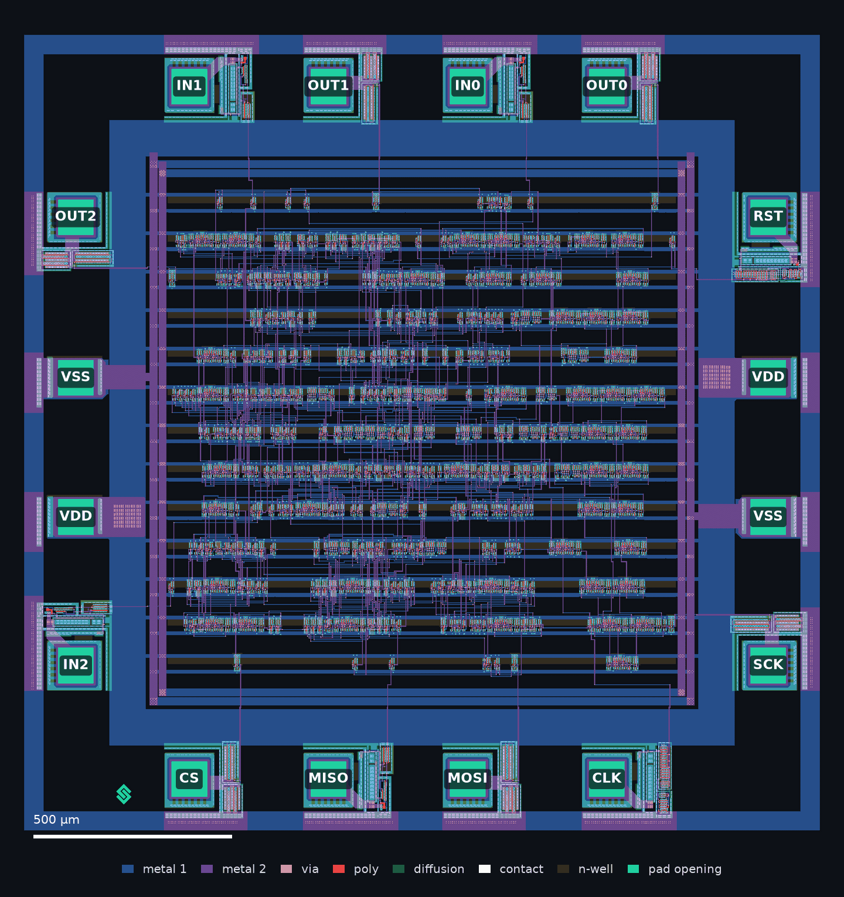
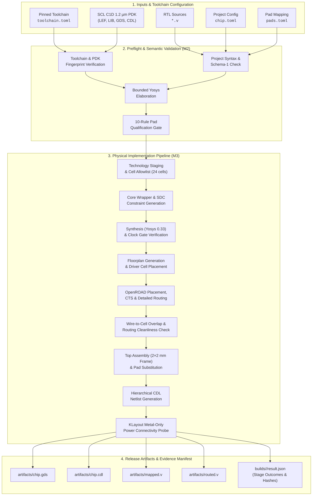
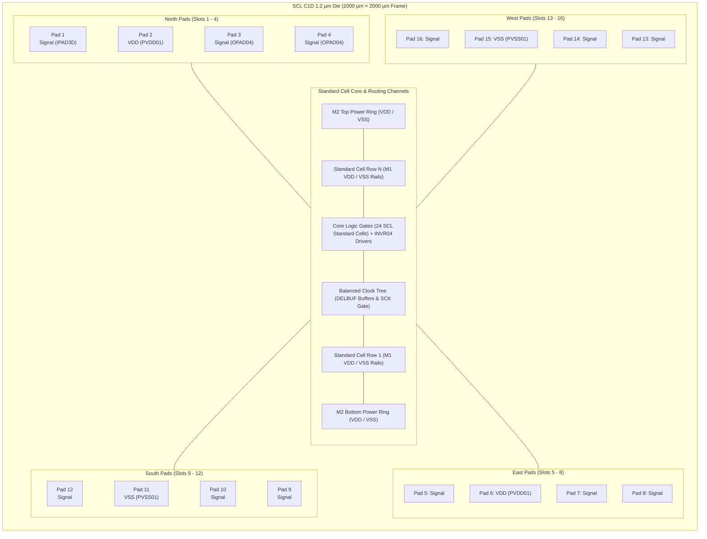
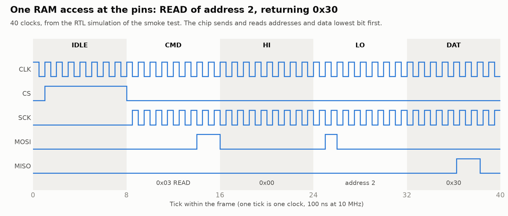
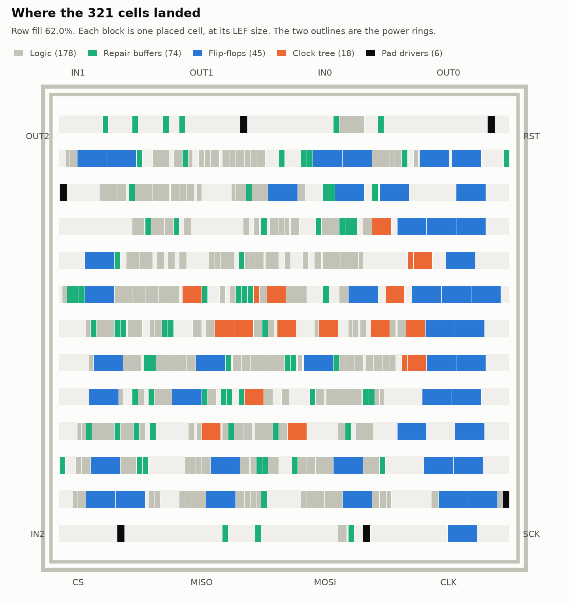
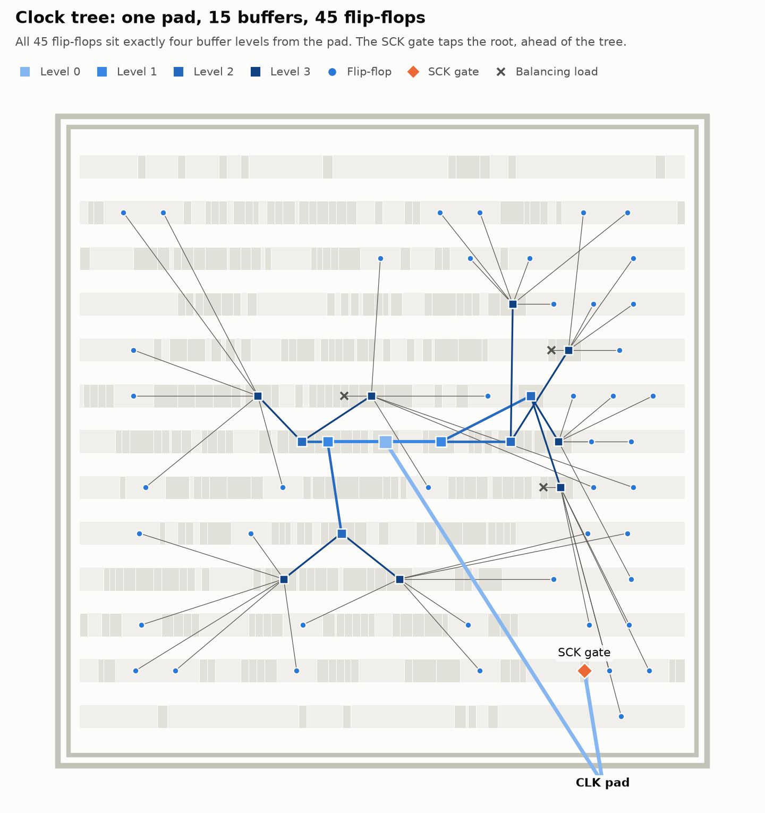
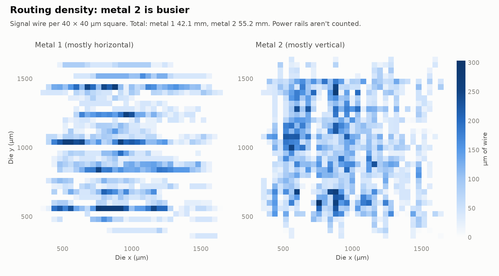
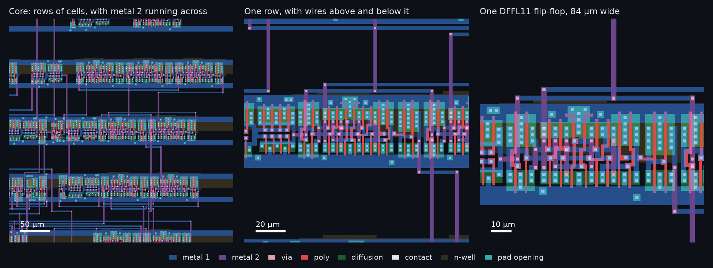

# Tapeout Automation (private)

`chipflow` is a private, provenance-first automation engine for digital standard-cell designs on the SCL C1D 1.2 µm, 2×2 mm frame. It validates project configuration and RTL, runs synthesis and physical implementation, and retains inputs, logs, artifact hashes and structured results for each run.


*Figure 1: Full assembled die layout on the SCL C1D 1.2 µm 2×2 mm frame (OS0000.gds), featuring 16 peripheral pad sites and central standard-cell core.*

---

## Current status and roadmap

As of **8 November 2026**, Milestones **1, 2 and 3** of [BUILD_PLAN.md](BUILD_PLAN.md) are complete. The current development package is **0.1.0.dev4**.


- **Milestone 1 — Reference and environment:** Immutable current-S8 engineering reference, contracts and inventories, plus a pinned binary runtime installed and probed in fresh isolated Ubuntu userspace.
- **Milestone 2 — Configuration and execution:** Strict schema-1 project and pad map loaders, bounded Yosys elaboration and clock cone analysis, 10 pad qualification checks, mapped netlist checking, isolated execution and provenance tracking. Full `chipflow validate` returns 0 on clean preflight.
- **Milestone 3 — Reusable physical flow:** Technology staging, synthesis, wrapper and constraint generation, OpenROAD placement/CTS/routing, GDS assembly, CDL generation and metal-only power connectivity checks. The S8 build produces all four canonical physical artifacts.

Milestone 3 verification records **114/114 tests passing in WSL2**, a passing S8 physical flow smoke run, a real CLI build producing the physical artifacts, and wheel verification in an isolated virtual environment. See the [Milestone 3 report](docs/milestone-3.md) and [implementation status](docs/implementation-status.md).

> [!WARNING]
> **Build completion is not yet signoff qualification.** DRC/LVS, timing and simulation verification adapters remain Milestone 4 work; broader S8/counter/PWM acceptance is Milestone 5, and clean-install qualification and the private v0.1 release are Milestone 6. The known raw parasitic extraction failure and unresolved manual items remain open; `signoff_ready` remains false.

---

## End-to-end automation architecture

The `chipflow` engine coordinates immutable run scheduling, deterministic tool invocations, and strict stage contracts from RTL to assembled layout.



---

## Physical architecture and die frame

The SCL C1D 1.2 µm frame provides a fixed 2000 µm × 2000 µm boundary with 16 peripheral pad sites (12 configurable signal pads and 4 dedicated power pads: 2× `PVDD01`, 2× `PVSS01`). Standard cells are organized in horizontal rows (height 48.7 µm, site pitch 4.2 µm) with M1 power rails and M2 top/bottom power distribution rings.



### Visual layout and physical evidence

| 2×2 mm Pad Frame Layout | Core Floorplan & Cell Rows |
|:---:|:---:|
|  |  |
| *Fixed 2×2 mm perimeter frame with 16 pad slots* | *Standard cell placement rows and horizontal channels* |

| Clock Tree Distribution | Routing Density & Congestion |
|:---:|:---:|
|  |  |
| *Balanced clock tree with clock-gate isolation hook* | *Global and detailed route congestion map* |


*Figure 2: Magnified view of core logic rows, standard-cell boundary alignment, and dual-layer routing (M1/M2).*

---

## Physical flow execution and retry loop

The physical flow implements automated retries during detailed routing (`TritonRoute`) by incrementally tuning global route layer adjustments (`0.04 × attempt`) to eliminate router DRC violations before layout assembly.


---

## Quick start

Use **Python 3.11 or newer**. Run EDA commands in **WSL Ubuntu 24.04, x86-64**, with the pinned tools and PDK inputs configured in `toolchains/local.wsl.toml`. That file contains machine-specific paths and hashes; use the [toolchain recipe](toolchains/README.md) and [pinned runtime reconstruction](toolchains/milestone1/README.md) for environment details. Installing the Python package alone does not install the EDA tools or PDK.

From the repository root, using the Python environment configured for those tools:

```bash
python -m pip install ./tools/chipflow
chipflow --version

# Check the pinned environment and run synthesis/geometry probes.
chipflow doctor --toolchain toolchains/local.wsl.toml --probe --run-root work/probes

# Check project structure without running EDA tools.
chipflow validate projects/s8/chip.toml --structure-only

# Run full semantic preflight: toolchain, elaboration and configuration.
chipflow validate projects/s8/chip.toml --toolchain toolchains/local.wsl.toml

# Run preflight and physical implementation.
chipflow build projects/s8/chip.toml --toolchain toolchains/local.wsl.toml
```

Each full validation or build creates a retained run under `projects/s8/builds/`. Runs include `result.json`, input and run manifests, and stage evidence. A successful physical implementation produces:

```text
artifacts/chip.gds
artifacts/chip.cdl
artifacts/mapped.v
artifacts/routed.v
```

The current full build **exits 2 even when physical implementation succeeds**, because required downstream verification checks remain `NOT RUN`. Inspect `result.json` for individual stage and check outcomes. Exit 0 from validation covers preflight only; it does not certify a chip. See the [result contract](docs/result-contract.md) for exit-code and evidence rules.

---

## Tests

From `tools/chipflow`, run the suite on Windows or Linux:

```bash
python -m unittest discover -s tests -v
```

Real-tool integration tests skip unless `CHIPFLOW_TEST_TOOLCHAIN` points to a configured toolchain file. To include them in the configured WSL environment:

```bash
CHIPFLOW_TEST_TOOLCHAIN="$PWD/../../toolchains/local.wsl.toml" python -m unittest discover -s tests -v
```

---

## Documentation

- [Build plan](BUILD_PLAN.md) and [implementation status](docs/implementation-status.md)
- [Milestone 1 reference](docs/milestone-1.md), [Milestone 2 report](docs/milestone-2.md) and [Milestone 2 closeout evidence](docs/milestone-2-verification.md#final-closeout-8-november-2026)
- [Milestone 3 physical flow and verification evidence](docs/milestone-3.md)
- [Getting started and environment details](docs/getting-started.md)
- [Project format](docs/project-format.md), [validation contract](docs/m2-validation-contract.md), [stage contracts](docs/stage-contracts.md) and [result contract](docs/result-contract.md)
- [Reference limitations](reference/milestone1/limitations.json)

This repository remains private. The source project and PDK are preserved; publication, uploads and source-project migration are outside the current workflow.
