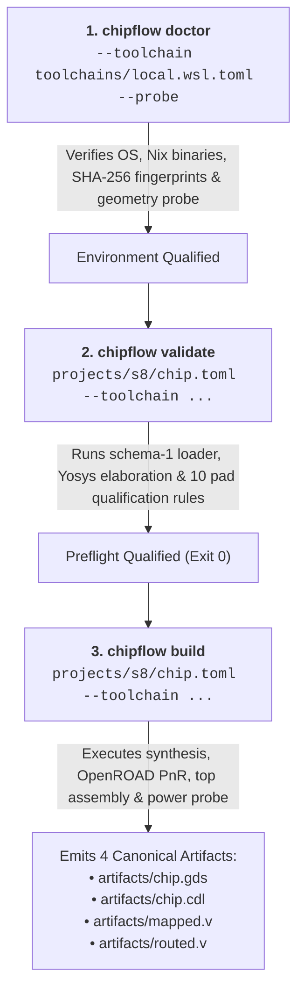
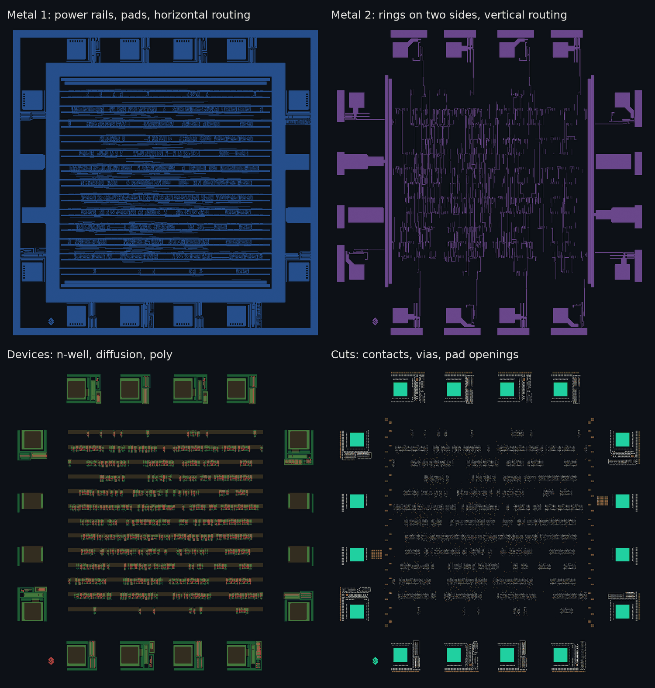

# Getting started with the foundation

`chipflow` separates three things: the generic engine coordinates runs, tools and
evidence; the SCL C1D 1.2 µm technology profile defines the currently supported
2×2 mm frame, cells and pad rules; each chip project supplies RTL, configuration,
constraints, pad mapping and tests. S8, a bit-serial 8-bit CPU, is the reference
example and the only project exercised through the physical flow so far. Other
supported designs use the same engine; other foundries and die sizes remain
outside the current scope. See [supported configurations](supported-configurations.md).

Run EDA commands in WSL Ubuntu 24.04 on x86-64. The current local installation is
described by `toolchains/local.wsl.toml`. It contains exact paths and hashes and
is deliberately separate from chip projects. [The environment recipe](../toolchains/README.md)
records what was recovered and what still needs a clean installation test.

Milestone 1's fresh userspace startup has now passed. For the pinned offline
runtime reconstruction rather than reuse of the local setup below, follow
[the milestone 1 recipe](../toolchains/milestone1/README.md). A clean WSL release
installation remains a separate gate.

---

## Toolchain and project workflow

The engine exposes three primary CLI commands matching the progressive verification gates.
The project commands in this diagram run the S8 reference example:




*Figure: S8 reference chip output on SCL C1D: standard-cell rows, contact, via, M1 and M2 layers.*

---

## Doctor and environment probe

From this project directory in WSL, the existing reference Python can run the source package:

```bash
cd tools/chipflow
/home/sushant/.venvs/presubmit-check/bin/python -m chipflow doctor \
  --toolchain ../../toolchains/local.wsl.toml --probe --run-root ../../work/probes
```

`doctor` checks the configured OS, Python, package versions, executable hashes,
version banners and 20 external technology input fingerprints. `--probe` then
maps a tiny synchronous counter using the real Liberty library, writes a GDS
with batch KLayout, verifies its geometry with the separately versioned Python
binding, and reads/checks the external 2 mm frame. Inputs embedded in tool
scripts use relative staged names. Every call creates a new retained run.

The gate is an environment check; its success does not certify a chip build or
the unused-pad policy. `SBY --version` in the reference installation prints
`unknown SBY version`; that exact banner is recorded, with the executable hash
and Nix-store identity retained separately.

---

## Package installation and offline verification

The source package is installable with `python -m pip install ./tools/chipflow`.
For offline installation of the built wheel, use:

```bash
python -m pip install --no-index --no-deps work/m2-dist-dev4/chipflow-0.1.0.dev4-py3-none-any.whl
chipflow --help
```

That interpreter must already have the pinned EDA Python dependencies for the
geometry probe. Packaging has no mandatory third-party Python dependency for
schema or runner use. The wheel verification script creates a local venv,
installs the wheel offline, confirms imports come from that venv, runs the
synthetic tests and exercises the environment gate:

```bash
/home/sushant/.venvs/presubmit-check/bin/python scripts/verify_wheel.py --workspace "$PWD" --wheel work/m2-dist-dev4/chipflow-0.1.0.dev4-py3-none-any.whl
```

---

## Project commands and execution boundaries

For your own chip, supply ordered RTL sources, `chip.toml`, `pads.toml`, clock and
I/O constraints in `chip.toml`, and declared tests/data dependencies. Follow the
[project format](project-format.md) and [current validation contract](m2-validation-contract.md);
the project-format example is a Milestone 1 structural example, not a physically
qualified template. Replace `path/to/chip.toml` below with your project file.
Supported projects use the shared engine without editing it.

Project commands have the following execution boundaries:

```bash
# Fast structural and syntax validation
chipflow validate path/to/chip.toml --structure-only

# Full semantic preflight validation (toolchain, elaboration, configuration)
chipflow validate path/to/chip.toml --toolchain toolchains/local.wsl.toml

# Full build: preflight + physical implementation (synthesis, PnR, assembly)
chipflow build path/to/chip.toml --toolchain toolchains/local.wsl.toml
```

Full validation returns 0 when toolchain, elaboration, and configuration checks pass,
and returns 2 on check failure.

`chipflow build` runs preflight validation, technology staging, synthesis, floorplanning,
OpenROAD placement, CTS with clock-gate isolation, detailed routing with retry tuning, top GDS
assembly in SCL's 2×2 mm frame, hierarchical CDL netlist generation, and KLayout metal-only power
connectivity checking. It copies all 4 release artifacts to `artifacts/`:

```text
artifacts/chip.gds
artifacts/chip.cdl
artifacts/mapped.v
artifacts/routed.v
```

The current build **exits 2 even when physical implementation succeeds**, because required
downstream verification checks (DRC, LVS, STA, simulation) remain `NOT RUN` pending Milestones 4 and 5.
See [result-contract.md](result-contract.md) for full exit-code and evidence rules.

---

## Unit and integration tests

Unit tests require no kit and run on Windows or Linux (114 tests; real-tool integration tests skip unless `CHIPFLOW_TEST_TOOLCHAIN` names a toolchain file). Run them from `tools/chipflow`:

```bash
# Windows
python -m unittest discover -s tests -v

# Linux / WSL
CHIPFLOW_TEST_TOOLCHAIN="$PWD/../../toolchains/local.wsl.toml" /home/sushant/.venvs/presubmit-check/bin/python -m unittest discover -s tests -v
```
