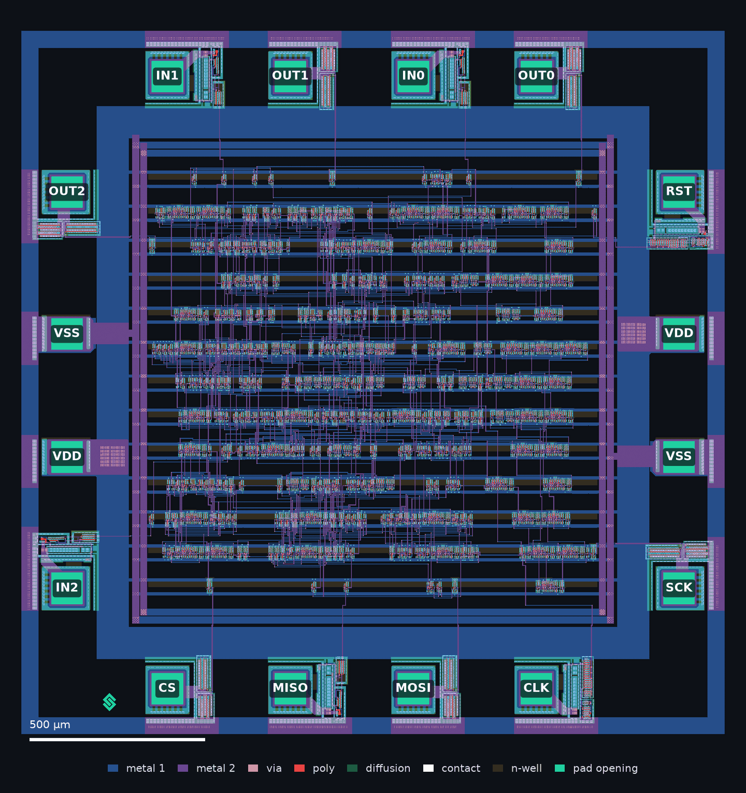
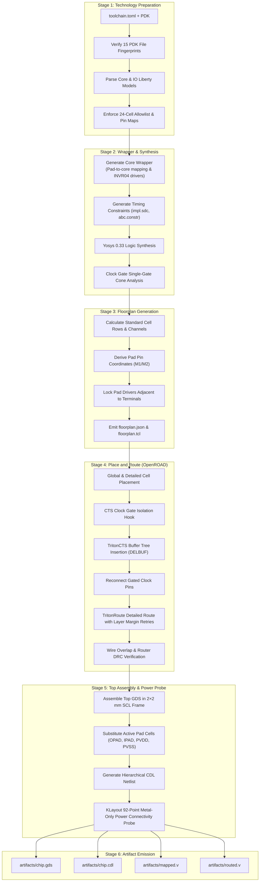
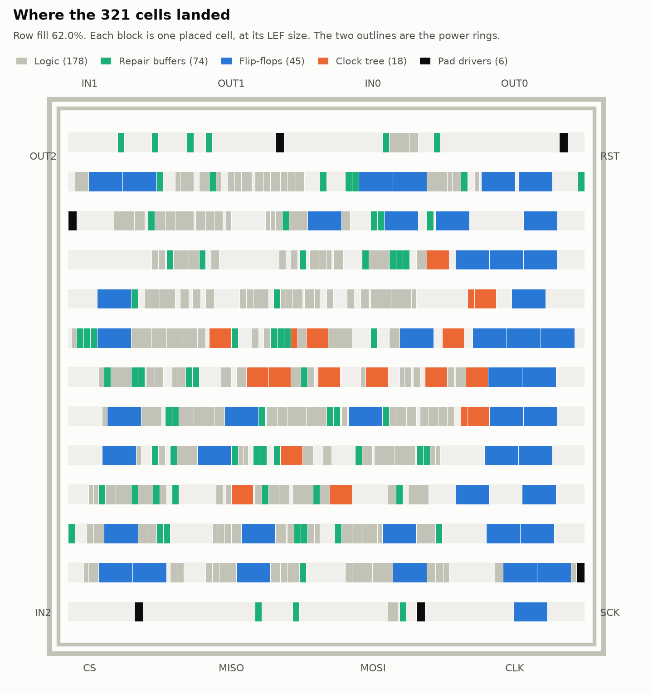
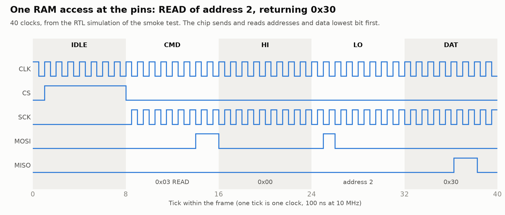
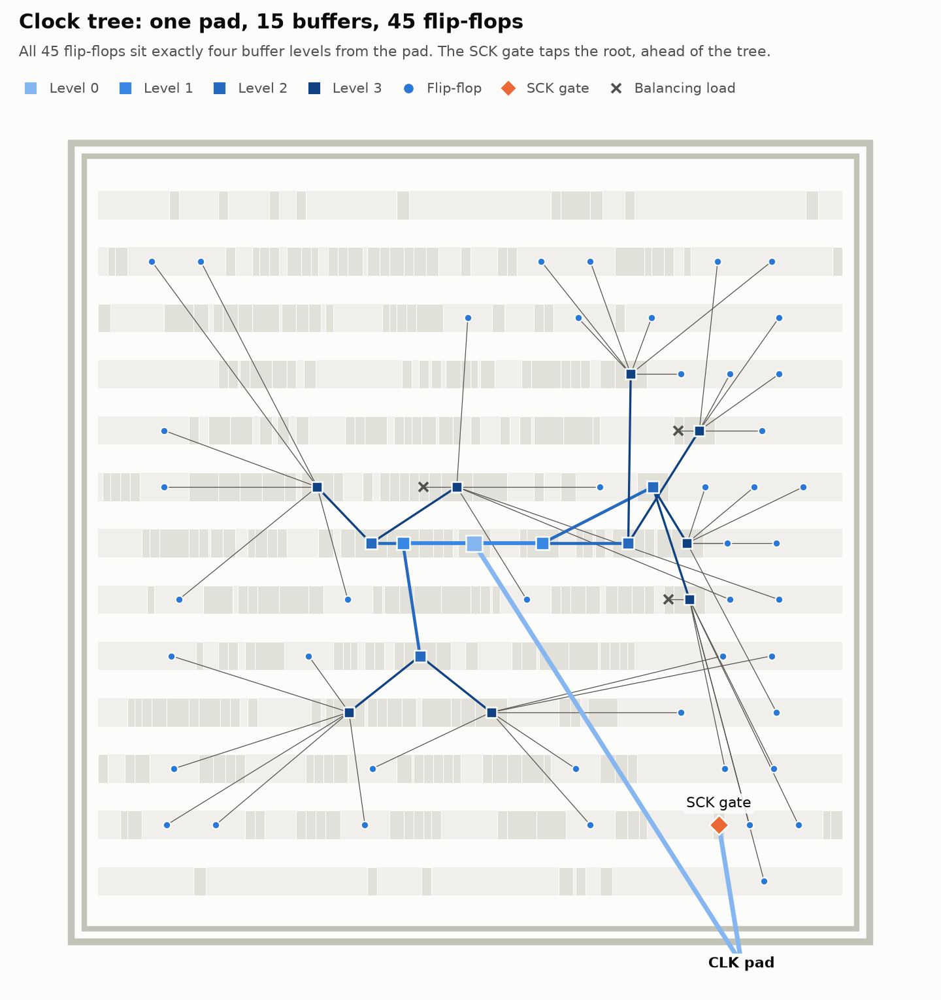
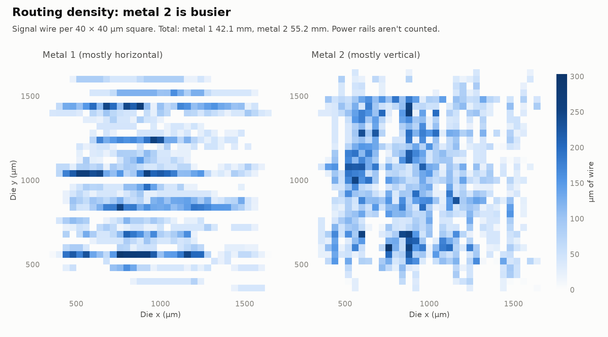
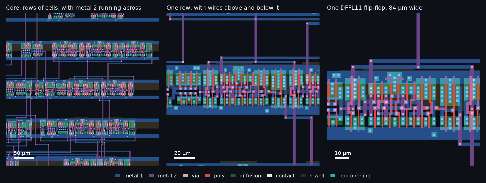
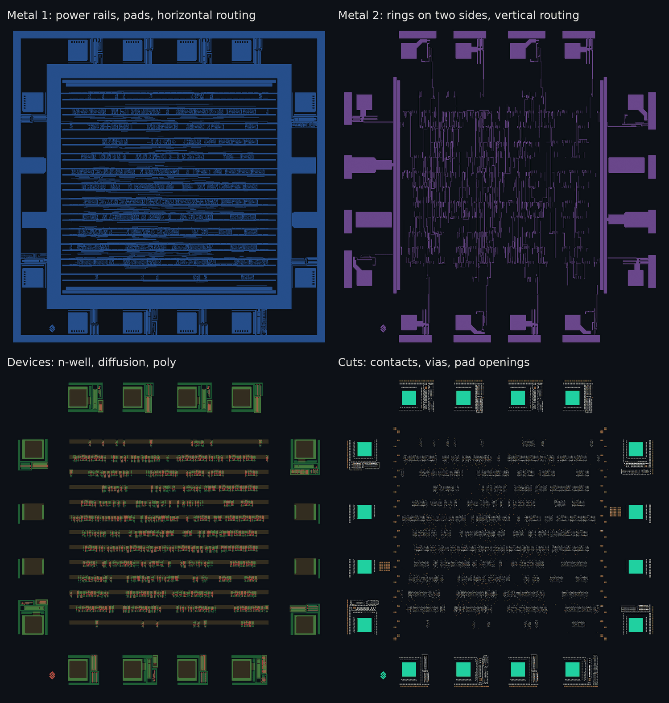

# Milestone 3: Extract the Reusable Physical Flow

**Verification closeout, 8 November 2026:** all five independent findings are fixed at 0.1.0.dev5. The expanded suite and installed-package physical builds pass; see the [closeout report](milestone-3-verification.md). The implementation account below is retained as the original 0.1.0.dev4 handback.

## 1. Overview

Milestone 3 delivers the reusable physical flow engine, with SCL C1D 1.2 µm on the 2×2 mm frame as its first supported technology profile. The engine coordinates physical synthesis, floorplanning, placement, clock tree synthesis (CTS), detailed routing with retries, top-level layout assembly, CDL schematic generation, and layout power connectivity checking. Process-specific cells, geometry and frame rules belong to the profile; chip-specific RTL, configuration, constraints, pad mapping and tests belong to each project.

All project-specific names, fixed pad positions, and absolute paths are eliminated from the shared engine. The reference chip S8 builds cleanly through the generic engine without hard-coded design assumptions.

S8 is a bit-serial 8-bit CPU and the only design exercised through the physical flow so far. All images below are S8 outputs on the SCL profile. The architecture diagram describes that supported profile's flow; it does not establish support for other foundries or die sizes. Broader S8/counter/PWM physical acceptance remains Milestone 5 work, and successful physical implementation still leaves the full build at exit 2 with downstream verification `NOT RUN` and `signoff_ready` false.


*Figure 1: S8 reference chip, assembled die (OS0000.gds) on the SCL C1D 2×2 mm pad frame.*

---

## 2. Reusable Physical Flow Architecture

The Milestone 3 engine coordinates seven decoupled stages, using strict stage envelopes and immutable input/output contracts:



---

## 3. Capabilities Delivered

### Technology Preparation (`stages/technology.py`, `resources/tech_prep.py`)
- Stages 15 required PDK files and verifies their SHA-256 fingerprints against `toolchain.toml`.
- Validates standard-cell LEF geometry against process profile (site `CORE`, site pitch 4.2 µm, height 48.7 µm, M1/M2 pitch 4.2 µm).
- Parses core and I/O Liberty libraries, ensuring cells match allowed lists and power pads (`PVDD01`, `PVSS01`) correctly carry `VDD` and `VSS`.
- Reconciles Liberty, CDL, and Verilog pin maps across all configured pad cells (`IPAD2D`, `IPAD3D`, `OPAD04`).
- Validates inverting drivers (`INVR04`) for output pads to preserve polarity across pad cells.

### Synthesis & Wrapper Generation (`stages/synthesis.py`, `stages/wrapper.py`, `stages/connectivity.py`)
- Generates a generic core wrapper mapping external pad pins to core ports, placing and wiring required pad drivers.
- Translates chip-level constraints (`[clock]`, `[io]`) to core-level constraints (`impl.sdc`, `abc.constr`).
- Maps RTL via Yosys 0.33 to the 24 allowlisted cells without unmapped `$` primitives, direct constant ties (P04 compliance), or illegal cells.
- Verifies clock connectivity and clock-gating structures (e.g. S8's SCK gate verified through single-gate cone analysis).

### Floorplan Generation (`stages/floorplan.py`)
- Derives channel tracks, standard cell row placements, and core bounding box from the frame profile and technology pitch.
- Determines pad pin locations (M2 for top/bottom, M1 in channels for left/right) and places pad drivers locked adjacent to corresponding pad terminals.
- Outputs `floorplan.json` metadata and OpenROAD `floorplan.tcl`.

| Floorplan & Core Rows | Pad Frame & Peripheral Terminals |
|:---:|:---:|
|  |  |
| *S8 output: standard-cell placement rows and horizontal channels* | *S8 output: SCL C1D frame boundary with 16 pad slots* |

### Place and Route (`stages/pnr.py`, `stages/wire_overlap.py`)
- Executes OpenROAD placement and CTS with density targets, slew/cap margins, and input buffering (`DELBUF`).
- Implements `cts_clock_gate_isolation` hook to disconnect non-DFF clock pins during CTS and reconnect them afterward, preventing TritonCTS divergence on gated clock trees.
- Executes detailed routing (`TritonRoute`) with retry loop adjusting global routing layer adjustments (`0.04 * TRY`).
- Checks routed DEF wires and vias against standard cell layout (`core.gds`), ensuring 0 router DRC violations and 0 unexpected wire-to-cell overlaps.

| Clock Tree Synthesis (CTS) | Routing Congestion & Density |
|:---:|:---:|
|  |  |
| *S8 output: clock tree with buffer insertion* | *S8 output: track routing density and metal utilization* |

### Assembly, CDL & Power Connectivity (`stages/assembly.py`)
- Assembles top-level GDS (`<TOP>.gds`, e.g. `OS0000.gds`) by instantiating the 2×2 mm frame, core block, power rings (M1/M2), and pad routing wires.
- Substitutes active pad cells (`OPAD04`, `IPAD3D`, etc.) into the frame instance array.
- Generates a hierarchical CDL netlist (`<TOP>.cdl`, e.g. `OS0000.cdl`) linking core gate instances, pad subcircuits, and power pads.
- Uses KLayout `LayoutToNetlist` to run a 92-point metal-only connectivity probe, confirming all row power rails connect to pad metal without shorts between VDD and VSS.

| Assembled Core Zoom | Physical Layer Breakdown |
|:---:|:---:|
|  |  |
| *S8 output: dual-layer routing (M1/M2) connecting standard-cell rows* | *S8 output: Contact, Metal 1, Via 1, Metal 2 layer stack* |

### CLI Integration (`cli.py`)
- `chipflow build` runs preflight validation (`toolchain` -> `elaboration` -> `configuration`), then executes physical stages (`technology` -> `synthesis` -> `pnr` -> `assembly`).
- Copies final physical outputs to `artifacts/`:
  - `artifacts/chip.gds`
  - `artifacts/chip.cdl`
  - `artifacts/mapped.v`
  - `artifacts/routed.v`
- Marks downstream verification checks (DRC, LVS, STA, simulation) as `NOT RUN` pending Milestones 4 and 5, returning exit code **2** per the specification contract.

---

## 4. Verification & Acceptance Evidence

### Full Test Suite (WSL2 Ubuntu 24.04)
- **114 / 114 tests passing** with `CHIPFLOW_TEST_TOOLCHAIN` active.
- Dependency-free Windows execution does not reproduce: CLI import requires KLayout and the suite reports 7 errors. See independent verification finding 5.

### Physical Flow S8 Smoke Test
```bash
/home/sushant/.venvs/presubmit-check/bin/python scripts/test_m3_s8_physical.py
```
- Elaboration: PASS
- Technology: PASS (15 PDK inputs verified, 24 cells allowed, 1 sequential)
- Synthesis: PASS (245 cells, 45 FFs, 0 direct ties, SCK gate verified)
- PNR: PASS (0 router violations after 1 attempt, 0 unexpected overlaps)
- Assembly: PASS (345 cells, 1386 fillers, 12 pad swaps, 92 power points verified with 0 problems)
- Top GDS: `OS0000.gds` (886,590 bytes)
- Top CDL: `OS0000.cdl` (37,872 bytes)

### Real `chipflow build` Run on S8
```bash
python -m chipflow build projects/s8/chip.toml --toolchain toolchains/local.wsl.toml
```
- Produced run directory in `projects/s8/builds/run-20261108T120503.511442Z-267df0c59d20`
- All 4 release artifacts copied to `artifacts/`: `chip.gds`, `chip.cdl`, `mapped.v`, `routed.v`
- Result contract: exit code 2 recorded with downstream checks `NOT RUN` (DRC, LVS, STA, simulation).

### Wheel Package Verification
- Built `chipflow-0.1.0.dev4-py3-none-any.whl` (106,584 bytes, SHA-256: `b3330fb7601b2363596a037f0040c9c3caac1c5905e68f46988db847e9751ecf`)
- Verified in clean isolated virtualenv via `scripts/verify_wheel.py`:
  - `create-venv`: PASS (0)
  - `install`: PASS (0)
  - `import-location`: PASS (0)
  - `tests`: PASS (0)
  - `doctor-probe`: PASS (0)
