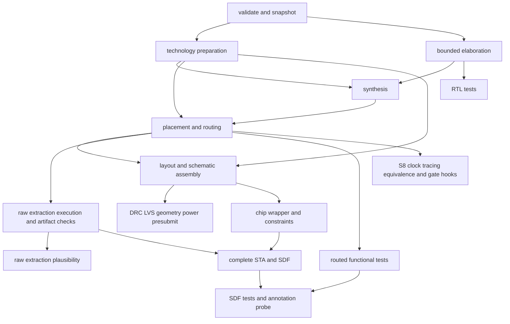

# Stage and evidence contracts for the first release

Contract version 1, engine 0.1 development series, SCL C1D profile 0.1.0. These
are the implementation acceptance contracts defined before extracting the
physical flow. This document does not claim that the physical adapters already
exist. The current structural loader, result types and command executor are
described in [project-format.md](project-format.md) and
[result-contract.md](result-contract.md).

## Ownership and project input boundary

The engine owns immutable runs, scheduling, argument arrays, safe output roots,
timeouts/cancellation, artifact hashes, content-validation failures and aggregate
results. The process profile owns cell/pad pin maps, frame geometry, units, allowed
transformations and model limitations. The S8 project owns its CPU and RAM tests,
output expectations, SCK-gate rules, seeded-start model variant and reviewed CTS
hook. Machine-specific tool and PDK paths belong to the separate local toolchain.

The `chip.toml` schema 1 contract is the typed structural interface already
implemented in `config/project.py`. Full configuration PASS additionally requires
the following semantic artifacts. Their implementation is a milestone 2 gate;
copying or parsing a companion file alone cannot satisfy that gate:

- `pads.mapping` names a versioned mapping with exactly one entry for every
  profile signal slot. An active entry identifies slot, elaborated scalar port
  or exact bus bit, pad-cell ID and compatible driver ID (or explicitly none for
  the tested input case). An unused entry names a tested profile policy ID with
  complete GDS/CDL treatment and defined CMOS input state. Power-pad inventory
  comes from the same frame profile and must reconcile with layout and schematic.
  The initial 2 mm reference has 12 signal and 4 power pads. These counts are
  profile invariants, not a generic frame-size formula.
- Verification input manifests, included in `verification.data`/`extra_files`,
  identify a versioned adapter, phase, ordered input/model/data dependencies,
  expected nonzero case count and exact case IDs, seeds, corners, expected result
  and independent oracle. An expected negative names a specific defect predicate;
  a crash, timeout, absent summary or empty comparison is never a detected defect.
- Ordinary clock and I/O constraints come from resolved typed configuration.
  Any additional reviewed SDC must be a snapshotted input and have an explicit
  hash, purpose, nonconflicting command definitions and nonempty resolved objects.
  No additional SDC support is implied by the current structural-only loader.
- Fixed 2 mm frame/floorplan defaults, track/grid values and bounded retry limits
  belong to the versioned profile. A user override cannot be accepted without a
  profile capability/range and an invariant validator. Unimplemented floorplan
  options remain unsupported rather than passing through to a shell.

Full validation reconciles the complete elaborated port set, scalar clock/reset,
contiguous one-dimensional packed bus indices, pad slots, every min/max I/O delay
and output load, timing corners, state elements, clocks and known cells. It rejects
black boxes, latches, asynchronous reset, internal generated/gated clocks and
unsupported interfaces. S8's externally gated SCK is one explicitly checked
project exception, not permission for generic internal clock gating.

## Stage envelope and artifact identity

Every stage receives an immutable resolved configuration and an input manifest:

```json
{
  "schema_version": 1,
  "stage_id": "synthesis",
  "adapter": {"id": "scl_c1d.synthesis", "version": "0.1.0"},
  "inputs": [{"id": "rtl", "path": "inputs/project/rtl/top.v", "sha256": "<64 lowercase hex>", "bytes": 123}],
  "tools": [{"id": "yosys", "executable_sha256": "<64 lowercase hex>", "version_evidence": "tool-versions.json"}],
  "configuration_sha256": "<64 lowercase hex>",
  "seed": 1,
  "threads": 1,
  "outputs": [{"id": "mapped_netlist", "path": "mapped.v", "validator": "mapped-netlist-v1"}]
}
```

The strings in angle brackets describe the field type, not executable manifest
values. Real manifests contain actual hashes and measured file sizes. Paths are
relative to the run or stage as specified and may not escape it. A private
tool-compatible staging directory has a retained original-to-staged path map,
with both source and copy hashes. Package resources resolve from the installed
package. Every external PDK/deck/model fingerprint is verified at consumption.
Transformed files retain source hash, transformation ID/version/parameters,
output hash and validation evidence. Kit originals are read only.

Execution uses an argument array, explicit working directory, bounded timeout,
recorded seed/thread count and relevant environment overrides. It records command,
start/end status, return code, separate full stdout/stderr and tool versions.
Every declared output must be new in the current stage directory, nonempty,
structurally valid and reconciled with expected inventory before it is hashed.
Prior-run artifacts cannot satisfy a new declaration. No v1 cross-run cache exists.

The result envelope is the implemented `StageResult`/`CheckResult`/`BuildResult`
schema. Execution `succeeded` does not establish check PASS. PASS/FAIL include
positive evidence and input hashes. A consumer must use the exact artifact hash
emitted by its producer; a filename or timestamp is insufficient identity.

## Dependency graph



The reporter runs after every outcome, including validation failure, blocked
stages and cancellation; it does not depend on successful implementation.
Independent diagnostics may run after an unrelated failure. The normal graph
blocks failed descendants. Diagnostic timing may consume raw extraction only
after successful execution and structural/unit/coverage checks, or consume a
separately requested estimate under a recorded diagnostic policy. It retains the
failed plausibility ancestor and cannot change the full-build nonzero result.
A tool crash or invalid artifact blocks all consumers. This diagnostic policy is
defined here; the current foundation executor conservatively blocks all failures.

## Required stage inputs, outputs and content gates

| Stage | Exact input identities | Required output/evidence | PASS/completeness gate |
|---|---|---|---|
| Validate/snapshot | chip/project companions, complete ordered source/include/test/hook set, toolchain and profile IDs | Resolved config, source/staged path map, dependency hashes, capabilities and validation rows | Semantic port/pad/constraint/state checks complete; no unsupported or unresolved input; no file drift during snapshot |
| Technology preparation | Raw Liberty min/typ/max, LEF, GDS/CDL/model/deck files and transformation registry | Working libraries/abstracts, pin/cell inventories, transform manifests, units | Every raw file matches its pin; deterministic intended changes only; counts and compatible pins reconcile; kit unchanged |
| Bounded elaboration | Ordered RTL, defines, parameters, includes and top, fixed Yosys version | Structured ports/nets/cells and elaboration log | Top exists; no black boxes; complete contiguous buses; supported state/clock/reset; include dependencies reconciled; timeout is infrastructure failure |
| Synthesis | Elaborated design, shared constraints, filtered mapped-library views | `artifacts/mapped.v`, structured connectivity/cell inventory and mapping log | Every retained cell/pin maps to known qualified technology; no unresolved primitives/black boxes; constants/aliases preserved; sequential clock/reset invariants rechecked |
| Placement and CTS | Mapped design, profile abstract/frame, translated core constraints, enabled project hooks | Placed database, floorplan manifest, placement/CTS inventories and hook before/after evidence | Units/grid/orientation/rows/pins valid; legal placement; all declared sequential clocks reachable; hook applies only to a structurally matched reviewed case |
| Detail routing | Placed database, routing limits/seed/thread/retry policy and overlap model | `artifacts/routed.v`, routed DEF/database, per-attempt logs, accepted-attempt ID, overlap report | Accepted attempt has process exit 0, completed final routing report, zero required violations and reconciled zero unexpected overlaps; exhausted retries fail |
| Assembly | Routed connectivity/geometry, raw cell/frame/pad GDS, complete pin/slot/CDL profile | `artifacts/chip.gds`, `artifacts/chip.cdl`, assembly/inventory/geometry reports | Exactly configured top/die; all instances/nets/pads accounted for; alias/constants and names preserved; physical and schematic pin mapping agree; unsupported DEF records fail |
| Geometry | Assembled GDS and origin/source inventory | Top/extent/grid/layer/via/metal-rule report | Positive expected shape/instance coverage; drawn vs inherited geometry scoped; no missing layer/top or silently skipped geometry; known kit warnings remain distinct |
| DRC | Exact assembled GDS/top and pinned raw/transformed deck | Full process log and marker XML plus category/violation inventory | Successful execution, valid report root/top, nonempty expected rule categories ran, no unexplained missing category, and no prohibited markers; zero items alone is insufficient |
| LVS | Exact layout, schematic/CDL/subcircuits, deck and top | Nonempty comparison database, extracted circuit and matching inventory | Expected top present, complete compared-circuit/device/net coverage and matching result; empty or truncated comparison is infrastructure failure |
| Automatic presubmission | Current GDS and corresponding DRC, profile/checker pins, declared development identifiers | Checker stdout, JSON rows, process code and tool-error metadata | Required rows all present, nonempty, scoped to exact hashes; tool errors/exit mismatch fail; WARN/MANUAL retained; placeholder ID is never a real silicon assignment |
| Metal-only power | Assembled GDS, profile supply pads/rings/rails and floorplan | Metal/via connectivity graph and expected probe inventory | VDD/VSS distinct; every required pad and row point is reached via metal, with positive expected count; substrate/well paths do not satisfy this check |
| Raw extraction execution | Routed database, exact RCX rule/model pin and tool | Raw SPEF, process log and extractor metadata | Execution completion and nonempty raw artifact are execution facts, separate from plausibility |
| Parasitic artifact/units/coverage | Raw SPEF and exact routed connectivity/units | Parsed network, units, net/pin coverage, positivity/finite-value and reconciliation report | Correct declared capacitance/resistance units; complete required nets/pins; no unmatched data silently accepted; valid values/top; invalid artifact blocks all timing consumers |
| Parasitic plausibility | Valid raw extraction plus independently identified comparison evidence | Raw totals/distributions and comparison/check row | Preserve actual FAIL for the known model defect with input hashes; a total-cap estimate does not validate electrical accuracy; unknown new defect cannot be exempted |
| Optional estimated parasitics | Valid routed DEF/connectivity, declared LEF/geometry model and estimate policy | Distinct estimate file and transform/comparison manifest | Explicit diagnostic request, complete matched coverage, documented approximations; retain raw artifact and failed-ancestor provenance; never replace raw-validation status |
| Chip STA | Wrapper/routed design, pad/core libraries, selected parasitic artifact, one resolved constraint source and all corners | Complete min/typ/max coverage/setup/hold/limit reports and matching SDF | Every retained sequential clock pin clocked; every expected path group and min/max I/O/load covered; exceptions nonempty; no unexplained unconstrained endpoints; setup/hold/slew/cap/fanout/pulse limits checked; missing corner/section fails |
| RTL functional | Frozen elaborated RTL, test adapter/data/oracle, expected case IDs/seeds | Structured per-case results and full logs | Expected nonzero tests ran; no failure/error/unexplained skip; compare independent expected outputs; a runner exit alone cannot pass |
| Routed functional | Exact routed design/wrapper/pad/core models, tests and startup policy | Case results, model-variant and source hashes, logs | Same explicit expectations; model stand-ins/overrides visible; zero-delay mode cannot qualify SDF |
| SDF functional/annotation | STA-matched models/hierarchy/SDF at requested corners, specify support, tests and startup variant | Per-corner results, annotation diagnostics/coverage, nonzero-delay probe | Correct instance paths/cell types/units/timescale/corner; actual nonzero known delay matches; no missing/ignored annotation or missing tests; simulation does not replace STA setup/hold |
| S8 project hooks | Explicit enabled S8 adapter, reviewed port/cone/protocol and exact model/tests | SCK structure/truth-table/margins, clock tracing, routed equivalence, RAM and seeded-start evidence | Dynamic current inventory; no S8 rule on an unrelated chip; expected nonempty cones/cases; preserve bounded-formal, simulation and model limits |
| Final reporting | All execution/check states, exact artifact inventories, limitations and unresolved manual items | Atomic JSON/readable report and delivery checksums | Always written; failed/blocked/skipped/NOT RUN visible; completion, automated verification and signoff separate; no failed check waived by expected-result qualification |

The GDS DBU is read from the artifact and checked against the profile; the
reference profile uses 0.001 um DBU and 0.005 um drawing grid. DEF DBU, LEF
micrometres, Liberty/SPEF capacitance and resistance, and SDF time units are
explicit fields, never guessed from file extension. The bounded current DEF
assembly assumes placed standard cells have orientation N; other records require
a supported interpreter and reconciliation rather than being silently dropped.

## Aggregate and qualification rules

The full-build minimum in `runner/results.py` is mandatory: configuration,
toolchain, elaboration, mapped netlist, routing, overlap, assembly, DRC, LVS,
automatic presubmission, metal-only power, parasitic artifact/units/coverage/
plausibility, timing coverage/setup/hold/limits and RTL/routed functional tests.
Canonical minimum artifacts are the four `artifacts/` paths listed above.
Release qualification adds min/typ/max SDF and annotation-probe evidence; S8's
established wider regression requirements cannot become optional by using a
generic project adapter.

Exit 0 requires all required automated checks PASS, valid required artifacts and
no executed FAIL. Exit 1 is a positively detected design/check failure, including
the extraction plausibility defect. Configuration/infrastructure/invalid or
missing required evidence gives exit 2 and takes precedence over exit 1.
Cancellation gives 130 and incomplete work. Conservative absence of required
artifacts is not converted into a design success. NOT APPLICABLE requires a
validated capability/precondition and evidence, not absence of a report.

Software qualification is a separate comparison of exact expected outcomes and
scope-bound known limitations. It may reproduce a documented extraction FAIL
and confirm full-build exit 1; it cannot relabel that chip build as passing or
ignore an extra failure. A negative fixture qualifies only when the intended
defect is positively detected and tool execution/result structure is valid.
Manual and foundry-policy items remain separate blockers. A milestone 1 reference
capture is neither full reusable-engine qualification nor chip signoff.
